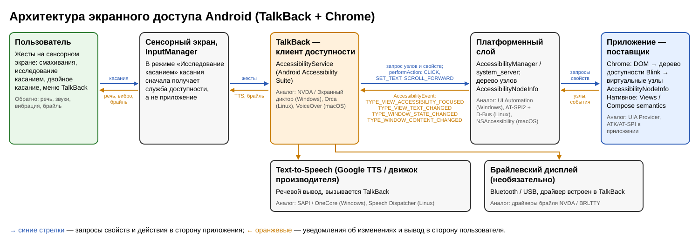

# Лабораторная работа № 4. Экранный доступ в мобильных ОС

**Выбранная ОС:** Android, скринридер TalkBack, браузер Chrome.
**Объект части 2:** собственная HTML-страница (`stand/before.html` — исходная версия, `stand/after.html` — исправленная), открытая в Chrome на телефоне.

> ⚠️ Блоки «Как получить» — инструкции для группы. Удалите их перед сдачей. Всё, что помечено ⟨…⟩, заполняется **только фактическими данными** с устройства.

## Состав группы и вклад участников

| Участник | Что сделал |
| --- | --- |
| ⟨Фамилия Имя⟩ | ⟨невизуальные действия 1–2, …⟩ |
| ⟨Фамилия Имя⟩ | ⟨…⟩ |
| ⟨Фамилия Имя⟩ | ⟨…⟩ |

---

# Часть 1. Невизуальная навигация и архитектура экранного доступа

## 1. Среда

| Параметр | Значение |
| --- | --- |
| Модель устройства | ⟨…⟩ |
| Версия Android, сборка | ⟨…⟩ |
| Оболочка производителя | ⟨One UI 6 / MIUI / HyperOS / Pixel UI / …⟩ |
| Версия TalkBack (Android Accessibility Suite) | ⟨…⟩ |
| Версия Chrome | ⟨…⟩ |
| Язык интерфейса / язык речи | ⟨русский / русский⟩ |
| Речевой движок и голос | ⟨Google TTS / Samsung TTS, голос …⟩ |
| Скорость речи, подробность озвучивания | ⟨…⟩ |
| Способ системной навигации | ⟨жесты / три кнопки⟩ |
| Быстрое включение TalkBack | ⟨удержание обеих клавиш громкости 3 с / кнопка спец. возможностей⟩ |
| Режим набора на клавиатуре | ⟨двойное касание / ввод при отрыве пальца⟩ |
| Автоописание изображений / распознавание значков | ⟨вкл./выкл.⟩ |
| Компьютер для инспекции | ⟨ОС, версия Chrome, Android Studio при наличии⟩ |

> **Как получить** (с подключённым по USB телефоном и включённой отладкой):
> ```
> adb shell getprop ro.product.model
> adb shell getprop ro.build.version.release
> adb shell getprop ro.build.display.id
> adb shell dumpsys package com.google.android.marvin.talkback | grep versionName
> adb shell dumpsys package com.android.chrome | grep versionName
> ```
> На Samsung TalkBack может иметь пакет `com.samsung.android.accessibility.talkback`. Версию также видно в Настройки → Приложения → Android Accessibility Suite. Распознавание значков/автоописание: меню TalkBack → Настройки → Подробные настройки / Описание изображений.

## 2. Освоение TalkBack

Использованные жесты (проверить и отметить, что реально сработало на устройстве):

| Жест | Действие | Проверено |
| --- | --- | --- |
| Удержание обеих клавиш громкости | Вкл./выкл. TalkBack (после настройки ярлыка) | ⟨да/нет⟩ |
| Смахивание одним пальцем вправо/влево | Следующий/предыдущий элемент | ⟨⟩ |
| Ведение пальцем по экрану | Исследование касанием | ⟨⟩ |
| Двойное касание | Активировать элемент в фокусе | ⟨⟩ |
| Смахивание двумя пальцами | Прокрутка | ⟨⟩ |
| Вниз-затем-вправо / касание тремя пальцами | Меню TalkBack | ⟨⟩ |
| Смахивание вверх/вниз одним пальцем | Переход по выбранной категории (заголовки, ссылки, элементы управления) | ⟨⟩ |

Встроенное обучение: ⟨сколько минут, какие разделы пройдены⟩.

**Фокус TalkBack и фокус ввода.** Фокус TalkBack (зелёная/жёлтая рамка) — это объект, который озвучен и будет активирован двойным касанием. Фокус ввода — элемент, который получает символы клавиатуры. ⟨Опишите собственное наблюдение: например, после ввода текста в поле поиска смахнули к кнопке — рамка TalkBack на кнопке, а курсор и клавиатура остались у поля.⟩

## 3. Объект исследования

Сайт: ⟨тот же, что в ЛР 3: URL⟩. Открыт в Chrome на Android. ⟨Если в прошлый раз было настольное приложение — укажите мобильный аналог и почему выбран.⟩

## 4–5. Протокол действий без зрительного контроля

Экран закрыт ⟨листом бумаги / включена «Тёмная пелена» (Dim screen) в меню TalkBack⟩; телефон не блокировался.

| № | Участник | Что хотел сделать | Жесты и способ поиска | Что произнёс TalkBack (дословно) | Получилось | Комментарий |
| --- | --- | --- | --- | --- | --- | --- |
| 1 | ⟨Фамилия И.⟩ | Найти поле поиска | Смахивания вправо | ⟨…⟩ | ⟨да/нет⟩ | ⟨сколько переходов⟩ |
| 2 | ⟨⟩ | Ввести запрос | Двойное касание по полю, набор на клавиатуре | ⟨…⟩ | ⟨⟩ | ⟨режим набора⟩ |
| 3 | ⟨⟩ | Активировать кнопку поиска | ⟨⟩ | ⟨⟩ | ⟨⟩ | ⟨⟩ |
| 4 | ⟨⟩ | Прокрутить страницу | Смахивание двумя пальцами вверх | ⟨⟩ | ⟨⟩ | ⟨⟩ |
| 5 | ⟨⟩ | Перейти к заголовку раздела | Меню TalkBack → Заголовки, смахивание вниз | ⟨⟩ | ⟨⟩ | ⟨⟩ |
| 6 | ⟨⟩ | Открыть и закрыть диалог / меню | ⟨⟩ | ⟨⟩ | ⟨⟩ | ⟨⟩ |

**Смахивания или исследование касанием.** ⟨Для какого действия что удобнее и почему. Опирайтесь на число переходов из протокола: например, смахивания надёжнее в форме — ничего не пропускается; касание быстрее, если известна раскладка экрана (кнопка вверху справа), но легко «промахнуться» мимо маленьких элементов.⟩

## 6. Таблица объектов

| Объект | Что видно | Что сообщает TalkBack | Роль/тип | Доступное имя | Состояние/значение | Доступное действие | Фраза настольного скринридера (ЛР 2–3) |
| --- | --- | --- | --- | --- | --- | --- | --- |
| ⟨Поле поиска⟩ | ⟨⟩ | ⟨фактическая фраза⟩ | ⟨по инспекции⟩ | ⟨по инспекции⟩ | ⟨⟩ | ⟨⟩ | ⟨NVDA: …⟩ |
| ⟨Кнопка⟩ | ⟨⟩ | ⟨⟩ | ⟨⟩ | ⟨⟩ | ⟨⟩ | ⟨⟩ | ⟨⟩ |
| ⟨Флажок / ссылка⟩ | ⟨⟩ | ⟨⟩ | ⟨⟩ | ⟨⟩ | ⟨⟩ | ⟨⟩ | ⟨⟩ |

> **Как получить свойства по инспекции** (не вписывайте свойства «по памяти»):
> - Семантика страницы: `chrome://inspect/#devices` на компьютере → Inspect → Elements → вкладка **Accessibility** (Role, Name и его источник, состояния).
> - Платформенное представление (то, что видит TalkBack): при включённом TalkBack выполните
>   `adb shell uiautomator dump /sdcard/ui.xml && adb pull /sdcard/ui.xml`
>   В XML ищите `class` (например `android.widget.Button`, `android.widget.EditText`, `android.widget.CheckBox`), `text`, `content-desc`, `checkable`, `checked`, `clickable`, `enabled`, `focused`. Это и есть данные `AccessibilityNodeInfo`.

## 7. Речевой, брайлевский и сенсорный вывод

- **Объект:** ⟨…⟩. **Речь:** ⟨дословная фраза⟩. **Звук/вибрация:** ⟨щелчок при смене фокуса, вибрация — если включены в Настройки TalkBack → Звук и вибрация⟩.
- **Брайлевский дисплей.** В современных версиях TalkBack поддержка брайлевских дисплеев встроена (раньше — отдельное приложение BrailleBack): Настройки TalkBack → Брайлевский дисплей. Дисплей подключают по Bluetooth (в новых версиях также по USB), после чего TalkBack выводит на него текст элемента в фокусе, сокращённую роль и состояние, а клавиши дисплея позволяют перемещать фокус, активировать элементы и вводить текст. ⟨Проверьте и опишите, как этот пункт называется и что в нём есть на вашем устройстве.⟩
- **Практическая проверка брайлевского вывода не проводилась: физического дисплея у группы нет.** ⟨удалить, если дисплей был⟩ Брайлевская экранная клавиатура TalkBack — это способ ввода, а не вывода, поэтому для проверки дисплея она не использовалась.
- **Сравнение с настольной ОС:** ⟨на ПК — речь, брайль, звуки NVDA, визуальная рамка; на телефоне добавляется вибрация, а клавиатурные команды заменены жестами; ввод — экранная клавиатура вместо физической…⟩

## 8. Архитектурная схема



**Пояснение своими словами.** Пользователь управляет телефоном жестами. Когда включён TalkBack, система переводит сенсорный экран в режим «Исследование касанием»: касания сначала получает служба доступности, а не приложение. TalkBack — **клиент доступности**, реализованный как `AccessibilityService`. Он запрашивает у системы дерево узлов `AccessibilityNodeInfo` (класс, текст, `contentDescription`, состояния, список действий) и вызывает `performAction` (`ACTION_CLICK`, `ACTION_SET_TEXT`, `ACTION_SCROLL_FORWARD`) — это поток в сторону приложения. **Поставщик доступности** — приложение: View-компоненты и Compose semantics сами формируют узлы; Chrome строит дерево доступности Blink из DOM и экспортирует его как виртуальные узлы. При изменениях приложение отправляет `AccessibilityEvent` (`TYPE_VIEW_ACCESSIBILITY_FOCUSED`, `TYPE_VIEW_TEXT_CHANGED`, `TYPE_WINDOW_STATE_CHANGED`, `TYPE_WINDOW_CONTENT_CHANGED`) через системный `AccessibilityManager` — это поток в сторону скринридера. TalkBack превращает данные во фразу и передаёт её движку Text-to-Speech, а при подключённом дисплее — на брайлевский вывод.

| Android | Windows (UIA) | Linux (AT-SPI) | macOS |
| --- | --- | --- | --- |
| TalkBack (`AccessibilityService`) | NVDA, Экранный диктор | Orca | VoiceOver |
| `AccessibilityNodeInfo` | `IUIAutomationElement` | `Accessible` | `AXUIElement` |
| `AccessibilityEvent` | UIA events (FocusChanged, PropertyChanged) | сигналы D-Bus (`object:state-changed`, `focus:`) | `AXNotification` |
| `performAction(ACTION_CLICK)` | Invoke Pattern | Action interface (`doAction`) | `AXPress` |
| Text-to-Speech | SAPI / OneCore | Speech Dispatcher | системная речь macOS |

---

# Часть 2. Исследование доступности мобильного интерфейса

## 1. Объект исследования

Собственная страница `before.html` (исходная) и `after.html` (исправленная) открыты в Chrome на телефоне ⟨модель⟩. Элементы: заголовки h1/h2, поле поиска, кнопка-иконка «лупа», флажок, ползунок, кнопка открытия диалога, модальный `<dialog>` с кнопкой «Закрыть», шесть разделов текста для прокрутки и журнал событий DOM внизу страницы.

Намеренно оставленные барьеры:
1. Поле поиска без программно связанной подписи: рядом только `<span>Поиск по каталогу</span>`, нет `<label for>`, `aria-label`, `placeholder` и `title`.
2. Кнопка поиска без доступного имени: внутри только SVG, скрытый через `aria-hidden="true"`.

> **Как открыть на телефоне.** Вариант А, по USB, без общей сети: `cd stand && python3 -m http.server 8000`, затем `adb reverse tcp:8000 tcp:8000` и на телефоне `http://localhost:8000/before.html` (через `adb reverse` адрес localhost на телефоне перенаправляется на компьютер). Вариант Б, по Wi-Fi: `python3 -m http.server 8000 --bind 0.0.0.0` и `http://IP-КОМПЬЮТЕРА:8000/before.html`. После работы остановите сервер (Ctrl+C) и выполните `adb reverse --remove-all`.

## 2. Инспекция — не менее пяти элементов

Инструменты: **(D)** Chrome DevTools → Accessibility (через `chrome://inspect`) — уровень DOM/браузера; **(P)** `uiautomator dump` — платформенный уровень `AccessibilityNodeInfo`; **(T)** фраза TalkBack на телефоне.

| Элемент | Источник/инструмент | Роль/тип | Имя и его источник | Значение и состояния | Действия | Родитель/группа |
| --- | --- | --- | --- | --- | --- | --- |
| Поле поиска | D / P / T | ⟨D: searchbox; P: android.widget.EditText⟩ | ⟨D: пусто — источников нет⟩ | ⟨⟩ | ⟨P: click, focus, set text…⟩ | ⟨⟩ |
| Кнопка-лупа | D / P / T | ⟨⟩ | ⟨⟩ | ⟨⟩ | ⟨⟩ | ⟨⟩ |
| Флажок «Получать новости» | D / P / T | ⟨⟩ | ⟨D: из label (обёртка)⟩ | ⟨checked: false/true⟩ | ⟨⟩ | ⟨⟩ |
| Ползунок «Громкость» | D / P / T | ⟨slider / SeekBar⟩ | ⟨label for⟩ | ⟨50, диапазон 0–100⟩ | ⟨scroll forward/backward = изменить⟩ | ⟨⟩ |
| Кнопка «Открыть условия акции» | D / P / T | ⟨⟩ | ⟨содержимое⟩ | ⟨⟩ | ⟨⟩ | ⟨⟩ |
| Диалог «Условия акции» | D / P / T | ⟨dialog⟩ | ⟨aria-labelledby → h2⟩ | ⟨modal⟩ | ⟨⟩ | ⟨⟩ |

Ближайшие аналоги трёх свойств в настольных API:

| Свойство Android | UIA | AT-SPI | macOS AX |
| --- | --- | --- | --- |
| `className` (роль) | `ControlType` | `Role` | `AXRole` |
| `contentDescription` / `text` (имя) | `Name` | `Name` | `AXTitle` / `AXDescription` |
| `isChecked` (состояние) | `ToggleState` | `STATE_CHECKED` | `AXValue` (0/1) |

## 3. Журнал изменений: фокус, значение, диалог

Источники разделены: **наблюдаемое поведение** (фраза TalkBack, видеозапись), **события DOM** (журнал страницы: `focusin`, `input`, `change`, `close` и запись приложения `dialog-open`), **события платформы** ⟨не регистрировались / зарегистрированы так: …⟩. События DOM — не журнал фокуса TalkBack.

| № | Действие | Источник доказательства | Событие, если зарегистрировано | Изменение фокуса/свойства | Фраза TalkBack | Результат |
| --- | --- | --- | --- | --- | --- | --- |
| 1 | Перейти смахиванием от заголовка к полю поиска | Видео + DevTools | ⟨DOM: focusin есть/нет⟩; платформа: ⟨не регистрировалось⟩ | ⟨фокус TalkBack на поле; фокус ввода — ⟩ | ⟨⟩ | ⟨⟩ |
| 2 | Изменить флажок / ползунок / ввести текст | Инспекция до/после + журнал DOM | ⟨change checked=true⟩ | ⟨checked false → true⟩ | ⟨⟩ | ⟨⟩ |
| 3 | Открыть и закрыть диалог | Видео + журнал DOM + DevTools | ⟨dialog-open activeElement=…; close activeElement=button#open-dialog⟩ | ⟨фокус внутри диалога: …; фон недоступен: да/нет; возврат на кнопку: да/нет⟩ | ⟨⟩ | ⟨⟩ |

> **Как снять журнал DOM.** Он виден внизу страницы и в DevTools → Console. Скопируйте строки как есть.
> **Платформенные события (необязательно):** `adb shell uiautomator events` печатает `AccessibilityEvent`. На некоторых устройствах это мешает работе TalkBack — тогда отметьте «не регистрировалось» и укажите это ограничение.

## 4. Барьеры

**Барьер 1. Поле поиска без подписи.** Элемент: `input#q` → у поля нет программного имени; текст «Поиск по каталогу» стоит рядом, но не связан с полем → пользователь TalkBack слышит только тип поля и не понимает, что в него вводить → воспроизведение: открыть `before.html`, смахнуть к полю. Подтверждение: TalkBack: «⟨…⟩»; DevTools: Name = ⟨пусто⟩; uiautomator: `text`/`content-desc` = ⟨пусто⟩.

**Барьер 2. Кнопка-иконка без имени.** Элемент: `button#search-btn` → внутри только декоративный SVG с `aria-hidden`, имени нет → пользователь слышит «⟨фактическая фраза, например «Кнопка» без названия⟩» и не знает её назначения → воспроизведение: смахнуть от поля вправо. Подтверждение: ⟨фраза, DevTools, uiautomator⟩. ⟨Если включено автоописание/распознавание значков и TalkBack угадал «поиск» — отметьте это отдельно: угаданная подпись ≠ программному имени; в DevTools имя всё равно пустое.⟩

## 5. Исправление барьера 2

До (`before.html`):
```html
<button type="button" id="search-btn" class="icon-btn">
  <svg aria-hidden="true" focusable="false" …>…</svg>
</button>
```
После (`after.html`):
```html
<button type="button" id="search-btn" class="icon-btn" aria-label="Найти">
  <svg aria-hidden="true" focusable="false" …>…</svg>
</button>
```
Почему так: видимого текста у кнопки нет, поэтому имя задаётся через `aria-label`. Иконка остаётся скрытой (`aria-hidden`), чтобы не влиять на вычисление имени. Слово «кнопка» в имя не добавлено: роль TalkBack сообщает сам. Барьер 1 (поле) специально не исправлен — он нужен для негативного теста. Его исправление было бы таким: `<label for="q">Поиск по каталогу</label>`.

## 6. Позитивный и негативный тесты

| | Позитивный | Негативный |
| --- | --- | --- |
| Устройство | ⟨модель, Android, TalkBack⟩ | то же |
| Страница | `after.html` | `before.html` (кнопка) + поле на `after.html` |
| Исходное состояние | Страница загружена, фокус TalkBack на заголовке h1, экран закрыт | то же |
| Шаги | 1) смахиваниями дойти до кнопки; 2) отдельно найти её исследованием касанием; 3) ввести запрос и дважды коснуться кнопки | те же шаги |
| Ожидаемый результат | TalkBack произносит «Найти, кнопка»; DevTools: Name = «Найти» (из aria-label); появляется «Найдено 3 результата…» | имя не произносится; назначение кнопки неясно; у поля нет имени и на `after.html` |
| Фактический результат | ⟨…⟩ | ⟨…⟩ |

## 7. Сравнение до и после

| Элемент | Свойства до | Фраза до | Свойства после | Фраза после | Результат сценария |
| --- | --- | --- | --- | --- | --- |
| Кнопка поиска | ⟨D: role button, name ""; P: Button, content-desc ""⟩ | ⟨⟩ | ⟨D: name «Найти» (aria-label); P: content-desc/text «Найти»⟩ | ⟨⟩ | ⟨сценарий поиска без зрения: до — ⟨⟩, после — ⟨⟩⟩ |

Диалог: начальный фокус — ⟨…⟩; фоновое содержимое при открытом модальном `<dialog>` ⟨недоступно/доступно⟩ для смахиваний; после «Закрыть» фокус ⟨вернулся на кнопку «Открыть условия акции» / ушёл…⟩.
⟨Если тот же барьер был на ПК — сравните: NVDA до исправления говорил «…», после — «…».⟩

---

# Итоговый вывод

⟨5–10 предложений на основе ваших данных. План:
1) Какую информацию получает TalkBack: роль (класс узла), имя (`text`/`contentDescription`, из DOM — вычисленное имя), состояния и список действий — приведите свою фразу.
2) Общее с настольной ОС: та же модель «объект — роль, имя, состояние, действия» и пара поставщик/клиент.
3) Что изменилось: жесты вместо клавиш, исследование касанием, прокрутка двумя пальцами, вибрация, экранная клавиатура.
4) Фокус TalkBack и фокус ввода — на вашем примере с полем.
5) Как исправление изменило сценарий (число переходов, успех без зрения).
6) Ограничения: DevTools показывает дерево браузера, а не полное платформенное; события TalkBack не журналировались / uiautomator; брайль не проверялся.⟩

**Приложения:** исходный и исправленный код — репозиторий https://github.com/WhyNot-png/lab4-talkback-android (`stand/before.html`, `stand/after.html`, `stand/common.js`); скриншоты/видео в папке `report/img/`.
